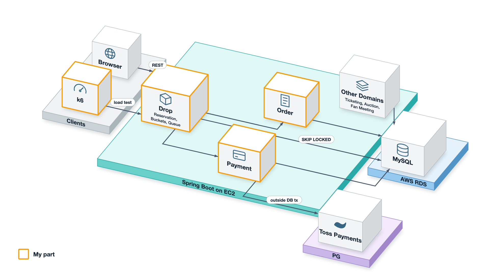
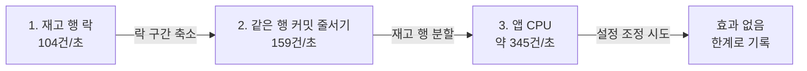
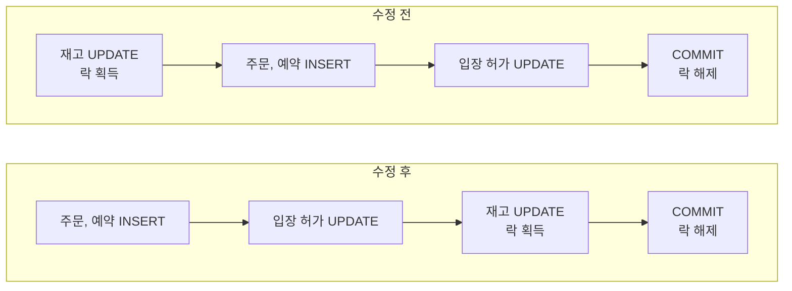
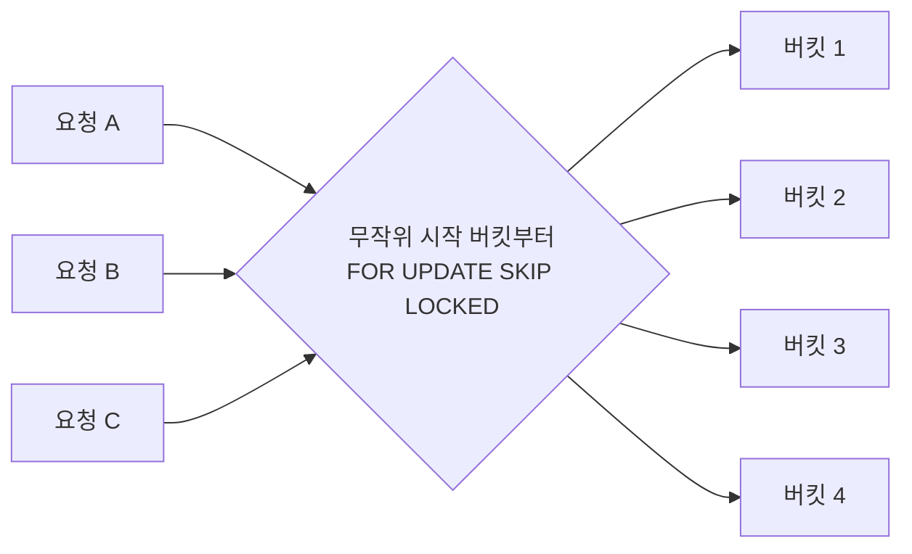

# 🛍️ FANQ 한정판 드롭: 재고 락을 줄여 처리량을 올린 기록

팬덤 이벤트 커머스 FANQ(Spring Boot, MySQL)에서 **한정판 드롭, 주문, 결제**를 맡아, 부하 테스트로 병목을 하나씩 찾아 고친 프로젝트입니다.
락 보유 시간 **9.64ms → 5.51ms**(포화 처리량 104 → 192건/초), 재고 행 분할로 처리량 **1.76배 이상**, CI **16분 → 6분 15초**.

> 모든 수치는 아래 [측정 조건](#측정-조건)에서 각 1회 측정한 값입니다.

## 👤 담당 역할 및 주요 구현

| 구분 | 구현 내용 | 위치 |
|---|---|---|
| 드롭 구매 | 멱등 키를 받는 점유 API, 재고 예약 트랜잭션(TX1), 점유 만료 | [`DropReservationService`](backend/src/main/java/com/restless/drop/application/DropReservationService.java), [`DropReservationTransactions`](backend/src/main/java/com/restless/drop/application/DropReservationTransactions.java) |
| 재고 버킷 | 한 상품의 재고를 K개 행으로 나누고 `FOR UPDATE SKIP LOCKED`로 빈 행을 고름 | [`DropInventoryRepository`](backend/src/main/java/com/restless/drop/infrastructure/DropInventoryRepository.java), [ADR-0005](docs/decisions/0005-drop-inventory-buckets.md) |
| 입장 제어 | 대기열 진입, 입장 허가 작업, 조회 간격 안내, 동시 처리 상한 | [`DropQueueService`](backend/src/main/java/com/restless/drop/application/DropQueueService.java), [`DropQueueAdmissionJob`](backend/src/main/java/com/restless/drop/application/DropQueueAdmissionJob.java) |
| 주문 | 공통 주문 생성 | [`OrderService`](backend/src/main/java/com/restless/order/application/OrderService.java) |
| 결제 | 토스페이먼츠 연동, 트랜잭션 밖 PG 호출, 미완료 결제 재확인 작업 | [`PaymentService`](backend/src/main/java/com/restless/payment/application/PaymentService.java), [`PaymentReconciler`](backend/src/main/java/com/restless/payment/application/PaymentReconciler.java), [ADR-0003](docs/decisions/0003-payment-module-boundary.md) |
| 부하 테스트 | k6 시나리오, 시드 데이터, EC2 측정 도구 | [`perf/`](perf/README.md) |
| CI와 검증 | 테스트 시간 단축, 위험도별 독립 검증과 머지 게이트 | [`.github/workflows/`](.github/workflows/), [`tools/verification/`](tools/verification/) |

## 🏗️ 시스템 아키텍처

한 배포 단위 안에서 도메인마다 패키지와 데이터를 나눈 모듈러 모놀리스입니다. 주황 테두리가 제가 맡은 drop, order, payment 모듈과 k6 부하 테스트입니다. 결제 모듈은 DB 트랜잭션을 닫은 뒤 PG를 호출합니다.

## 🔧 트러블슈팅

성능 작업은 **측정 → 병목 하나 확인 → 그것만 수정 → 같은 조건으로 재측정** 순서로 반복했습니다. 재측정 전에는 예측을 먼저 적고, 매 실행 뒤 재고와 금액 불변식을 SQL로 확인했습니다.

### 1. 재고 행 하나에 요청이 줄을 서서 104건/초에서 멈춤

- **문제**: 인기 상품 하나에 구매가 몰리면 처리량이 104.2건/초에서 더 오르지 않았습니다. 이때 EC2 CPU는 약 31%, RDS는 약 36%로 여유가 있었습니다. 행 잠금 대기는 20,562회, 평균 약 103ms, 최대 3,434ms였습니다.
- **원인 확인**: 재고 행 락을 쥔 시간이 평균 9.64ms였습니다. 1000 ÷ 9.64 ≈ 104로 실측 처리량과 맞았습니다. 그래서 병목은 CPU나 커넥션 풀이 아니라 **재고 행 하나의 락**이라고 판단했습니다.
- **선택**: 점유 트랜잭션(TX1)에서 주문, 예약 INSERT와 입장 허가 UPDATE를 먼저 실행하고, **재고 UPDATE를 맨 마지막**으로 옮겼습니다. 락을 잡은 뒤에는 커밋만 남습니다. 락을 기다리는 동안 판매가 끝났을 수 있으므로, 락을 얻은 뒤 판매 종료와 허가 기한을 다시 확인하고 지났으면 전체를 롤백합니다.
- **검토한 대안**: 커밋 동기화(`innodb_flush_log_at_trx_commit`) 완화는 결제 데이터를 다루므로 제외했습니다. 커넥션 풀을 40으로 늘리는 안은 락이 먼저 막히므로 포화점을 옮기지 못한다고 예측해 측정하지 않았습니다.

- **검증** (PR #324)

| 항목 | 수정 전 (11-20) | 수정 후 (11-21) |
|---|---|---|
| 락 보유 시간 평균 | 9.64ms | 5.51ms (-43%) |
| 포화 처리량 | 104.2건/초 | 약 192건/초 (+85%) |
| 행 잠금 대기 평균 / 최대 | 103 / 3,434ms | 60 / 383ms |
| 재고, 금액 불변식 위반 | 0 | 0 |

- **틀린 예측**: 락 시간 2~3ms, 포화 250건/초 이상을 예상했지만 둘 다 빗나갔습니다. 커밋 구간을 따로 재는 타이머를 추가해 보니(PR #326) 락 시간 6.22ms 중 6.22ms가 COMMIT이었고, 커밋 전 작업은 0.01ms였습니다. **더 줄일 것은 코드가 아니라 커밋 자체**였고, 이것이 다음 단계로 이어졌습니다.

### 2. 커밋만 남은 락도 같은 행이면 줄을 섬: 재고 행 분할

- **문제**: 락 구간에는 약 6ms짜리 커밋만 남았지만, 모든 요청이 같은 행을 쓰면 커밋도 한 줄로 섭니다. 이 단계의 포화점은 약 159건/초였습니다.
- **선택**: 상품 하나의 재고를 `drop_inventory_buckets` 테이블의 **K개 행(기본 4)** 으로 나눴습니다. 무작위로 고른 버킷부터 `FOR UPDATE SKIP LOCKED`로 잠기지 않은 행 하나를 집고, 모든 버킷이 잠겼을 때만 한 버킷을 기다립니다. 어떤 버킷에서 뺐는지 `drop_reservations.bucket_no`에 남겨, 반환할 때 같은 버킷으로 돌려줍니다.
- **검토한 대안** ([ADR-0005](docs/decisions/0005-drop-inventory-buckets.md)):

| 대안 | 고르지 않은 이유 |
|---|---|
| 커밋 동기화 완화 | 결제 데이터의 내구성을 낮춤 |
| 버킷마다 조건부 UPDATE를 차례로 시도 | 로컬 MySQL 8.4에서 교착 상태 재현 |
| 한 번 기다린 뒤 0행이면 품절 처리 | 재고가 남았는데 품절로 응답하는 거짓 품절 재현 |
| 반환할 때 아무 버킷에 돌려주기 | 버킷 단위 정합성을 검사할 수 없음 |
| Redis 앞단 재고 | 새 인프라와 이중 기록이 필요함 |

- **검증** (PR #334, 30 → 300건/초 램프 18분)

| 항목 | K=1 (11-22) | K=4 (11-23) |
|---|---|---|
| 포화 처리량 | 약 159건/초 | 300건/초 도착까지 포화 없음, 마지막 2분 평균 279.6건/초 |
| 먼저 찬 자원 | 재고 행 락 | 앱 CPU |
| 불변식 위반 | 측정 뒤 확인 못 함 | 드롭 불변식 13개 모두 0 |

처리량은 최소 279.6 ÷ 159 = **1.76배**로, 미리 정한 성공 기준 1.4배를 넘었습니다. 150 → 450건/초 램프로 다시 재자 K=4의 상한은 약 345건/초였습니다.

### 3. 다음 병목은 앱 CPU: 측정해 보니 효과가 없어 되돌린 두 시도

- **문제**: K=4 상한 약 345건/초에서 EC2 CPU는 91.43%, RDS는 85.55%, 앱 CPU는 0.92~0.98이었습니다. 락 모델로 계산한 상한 400건/초보다 실측이 15% 낮아, 락이 아니라 **앱 CPU가 먼저 찼다**고 판정했습니다.
- **원인 확인**: JFR로 CPU를 프로파일링하자 MySQL 드라이버가 21.1%였고, 그중 SQL 파싱이 15.0%였습니다. TX1 한 건은 DB 왕복이 20번이었고, 그중 5번은 세션 설정 문장이었습니다.
- **시도와 판정**: 효과 기준을 미리 정하고 두 가지를 측정했습니다. 둘 다 기준에 못 미쳐 되돌렸습니다.

| 시도 | 변경 | 결과 | 판정 |
|---|---|---|---|
| 문장 캐시 | `cachePrepStmts=true` 등 드라이버 설정 | 포화 +3%, 드라이버 표본 21.1% → 7.0% | 기준 +10% 미달, 되돌림 |
| 세션 문장 제거 | `useLocalSessionState=true`, DB 왕복 20 → 17번 | 요청당 CPU 4.579 → 4.756ms (+3.9%) | 기준 -5% 미달, 되돌림 |

- **배운 점**: JFR 표본은 커널, GC, JIT 시간을 빼고 셉니다. 그래서 표본 비율이 크게 줄어도 실제 CPU는 거의 줄지 않았습니다. 이후 CPU 개선은 누적 `process_cpu_time_ns_total`로 **요청당 CPU 시간**을 비교합니다.

### 측정 조건

| 항목 | 값 |
|---|---|
| 앱 | AWS EC2 t3.small 1대, Hikari 풀 20, Tomcat 스레드 200 |
| DB | RDS MySQL small, `innodb_flush_log_at_trx_commit=1`, `sync_binlog=1` |
| 부하 | k6 2.4.0, 노트북에서 실행, 도착률 램프 |
| PG | 가짜 PG, 응답 300ms |
| 시나리오 | 1번은 인기 상품 1개, 2번과 3번은 같은 조건에서 버킷 수만 바꿈 |
| 횟수 | 조건마다 1회. 측정일은 2026-11-20 ~ 11-23 |

원본 측정 데이터는 공개하지 않습니다. 측정 계획과 규약은 [drop-performance-plan](docs/testing/drop-performance-plan.md), [측정 규약](docs/testing/drop-performance-measurement.md)에 있습니다.

### 그 밖의 작업

| 작업 | 내용 |
|---|---|
| PG 결과 불명확 처리 | 승인 응답을 받지 못하면 실패로 처리하지 않고 `Unknown`으로 남깁니다. 미완료 결제 재확인 작업이 PG에 다시 물어 결과를 맞춥니다. 로컬에서 승인 응답 240건을 유실시키자 약 21초 안에 240건 모두 결제 승인, 주문 PAID로 맞춰졌습니다 |
| 중복 요청 방지 | 점유 API는 `Idempotency-Key`가 필수이고, 같은 키가 오면 기존 결과를 그대로 돌려줍니다. k6도 시간 초과 때 같은 키로 재시도하게 바꿔, 재시도 47건 중 42건이 회복됐고, 재시도 뒤 실패는 0건이었습니다. 확정 점유와 판매 수량은 1,000건으로 일치했습니다 (PR #406) |
| CI 단축 | 16분 중 12분이 테스트 context마다 MySQL 컨테이너를 새로 띄우는 시간이었습니다. 컨테이너를 공유하고 테스트를 병렬로 나눠 CI를 약 16분 → 6분 15초로 줄였습니다. 드롭만 바꾼 PR은 관련 테스트만 골라 3분 9초입니다 |
| AI 개발 하네스 | Codex가 구현하고 Claude가 새 맥락에서 독립 검증합니다. 변경 위험도를 diff로 분류해 높음 등급만 머지 전 독립 검증을 요구하는 머지 게이트를 만들었습니다 |

## 🔍 한계와 개선 방향

| 한계 | 개선 방향 |
|---|---|
| 300건/초 3분 유지 시험에서 성공률 99.97%는 통과했지만, p95 336.3ms(기준 200ms)와 p99 1,142.0ms(기준 500ms)는 미달 | 주문 생성을 점유 뒤로 미루는 구조 변경 검토. 팀 결정이 필요한 범위 |
| 모든 측정이 조건마다 1회. 측정 규약은 전후 각 3회를 요구 | 결론이 걸린 비교부터 반복 측정 |
| K=1과 K=4를 다른 날 측정. K=1은 측정 뒤 불변식 확인 누락 | 같은 날 번갈아 측정 |
| 버킷당 락 시간이 6.39 → 8.26 → 약 10ms로 늘어난 원인 미확인 | 커밋 구간 타이머로 부하별 분해 |
| 매분 정각에 0.1~0.8초 응답 정체가 모든 측정에 섞임. 권한 부족으로 원인 미확정 | RDS 지표 권한 확보 후 재조사 |
| EC2 사양을 키우지 않고 t3.small 한 대로만 측정, DB도 한 대 | 서버를 늘린 측정은 대기열 작업과 함께 정리 예정 |
| 가짜 PG 300ms 기준의 합성 처리량이라 실제 구매 완료 처리량과 다름 | 실제 PG에는 부하 테스트를 하지 않는 것이 원칙. 결과 해석에만 반영 |

## 📋 프로젝트 정보

| 항목 | 내용 |
|---|---|
| 과정 | 프로그래머스 데브코스 백엔드 12기 14회차 최종 프로젝트 |
| 기간 | 2026-11-01 ~ 2026-12-07 |
| 팀 | 쉬고 싶지 않음 청년, 4명 |
| 원본 레포 | [prgrms-be-devcourse/NBE12-14-final-RESTLESS](https://github.com/prgrms-be-devcourse/NBE12-14-final-RESTLESS#readme) |
| 원본 README 보존본 | [docs/SETUP.md](docs/SETUP.md). 전체 기능과 실행 방법은 여기서 봅니다 |

| 이름 | 담당 | 주요 작업 |
|---|---|---|
| **이태호 (본인)** | **한정판 드롭, 주문, 결제, 배포, CI/CD, 부하 테스트 환경** | **재고 예약, 입장 대기열, 재고 행 분할, 미완료 결제 재확인** |
| 송혜민 | 티켓팅, 공연, 공연장 | 좌석 선점, 티켓 발급, 티켓 환불, 좌석 조회 성능 개선 |
| 천종원 | 경매, 크레딧 | 경매 등록과 입찰, SSE 실시간 상태, 크레딧 충전 |
| 홍승연 | 팬미팅 추첨, 인증, 회원 | JWT 인증, 응모, 추첨, 예비 승격 |

## 🛠️ 기술 스택

| 영역 | 기술 |
|---|---|
| 백엔드 | Java 21, Spring Boot 4.1, Spring Data JPA, Flyway |
| 데이터베이스 | MySQL 8 (RDS) |
| 결제 | 토스페이먼츠 테스트 환경 |
| 테스트 | JUnit, Testcontainers, ArchUnit, k6, JFR |
| 인프라 | AWS EC2, RDS, Docker, GitHub Actions, GHCR |
